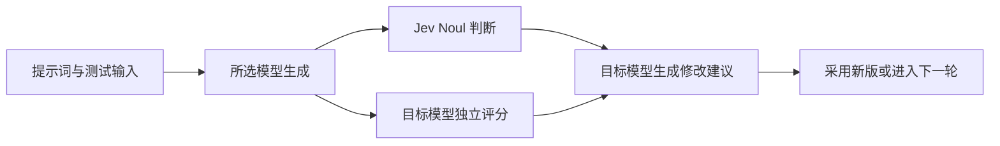

<div align="center">
  <h1>PromptLattice</h1>
  <p><strong>提示词评测与迭代工作台</strong></p>
  <p>用真实模型跑提示词，由 Jev 与目标模型分别评估，再按结果逐轮优化。</p>
  <p>
    
    
    
    
  </p>
</div>

PromptLattice 面向本地单人使用，帮助你检查提示词在目标模型上的实际表现。期望效果和参考答案只参与评估，不会偷偷混入生成请求；每轮输入、输出、评分和提示词版本都会保存在本机，便于比较和复现。

**快速导航：** [工作流程](#工作流程) · [功能](#功能) · [快速开始](#快速开始) · [支持的模型](#支持的模型) · [评估规则](#评估规则) · [数据与密钥](#数据与密钥) · [开发检查](#开发检查)

## 工作流程



Jev 负责判断**本次输出**是否符合期望；模型独立评估输出质量，并生成修改理由和完整的新提示词。自动优化会继续使用上一轮生成的新提示词，直到双阈值达标、达到轮数上限、用户停止或请求失败。

## 功能

| 测试与生成 | 评估与优化 | 记录与隐私 |
| --- | --- | --- |
| User 消息或 System 提示词 | Jev Noul 达标判断 | 每轮结果写入本地 SQLite |
| 显示实际发送的消息结构 | 目标模型独立评分 | JSON / Markdown 导出，不含 API Key |
| DeepSeek、Qwen、Kimi、OpenAI | 完整新版提示词与参数建议 | API Key 仅在本次运行内存中使用 |
| 手动迭代与 1–15 轮自动优化 | 自动沿用下一版提示词与受支持参数 | 主题偏好可持久化，密钥不持久化 |

## 快速开始

### 环境要求

- Python 3.10+
- Node.js 20.9+ 与 npm
- 真实评测需要所选模型的 API Key，以及 TypeSafe Jev API Key

### 启动后端

```bash
cd backend
python3 -m venv .venv
source .venv/bin/activate       # Windows: .venv\Scripts\activate
pip install -r requirements.txt
uvicorn app.main:app --reload --port 8000
```

### 启动前端

在另一个终端运行：

```bash
cd frontend
npm install
npm run dev
```

打开 <http://localhost:3000>。Next.js 检测到端口占用时可能改用 3001；本地 FastAPI 默认允许这两个端口。API 交互文档位于 <http://localhost:8000/docs>。

第一次体验可点击“体验演示运行”，不需要 API Key，也不会调用模型或 Jev。真实评测前，在模型设置中填入模型 Key 和 Jev Key。

## 支持的模型

模型清单允许手动输入 ID，避免预置列表过时后无法调用。Qwen 与 Kimi 可选中国内地或国际站入口。

| 服务商 | 预置模型示例 | 接口与参数说明 |
| --- | --- | --- |
| DeepSeek | `deepseek-flash`、`deepseek-v4-pro` | 支持思考模式配置；推理模式的采样参数按能力表禁用；不发送 Top-k。 |
| 通义千问 Qwen | `qwen3.8-max`、`qwen3.8-flash`、`qwen-plus`、`qwen-max` | DashScope 内地 / 国际站。Top-k 仅对已核对的模型 ID 发送。 |
| Moonshot / Kimi | `kimi-k3.1-pro`、`kimi-k3`、`kimi-k2.6`、`kimi-k2.5` | Moonshot 内地 `.cn` / 国际站 `.ai`；不发送 Top-k。 |
| OpenAI GPT | `gpt-4.1-mini`、`gpt-4.1`、`gpt-5.4` | 推理模型的 Temperature / Top-p 按接口能力禁用；不发送 Top-k。 |

Temperature、Top-p、Top-k 和最大输出 Token 会按服务商、模型、区域及思考模式配置。不支持的参数会禁用且不会发送；自定义模型的能力不一定能自动判断，具体行为请以对应模型文档为准。

官方接口文档：

- [DeepSeek Chat Completions](https://api-docs.deepseek.com/api/create-chat-completion/) · [Thinking Mode](https://api-docs.deepseek.com/guides/thinking_mode/)
- [Qwen OpenAI 兼容接口](https://help.aliyun.com/en/model-studio/qwen-api-via-openai-chat-completions)
- [Kimi Chat API](https://platform.kimi.ai/docs/api/chat) · [Moonshot 国际站 API](https://platform.moonshot.ai/docs/api/chat)
- [OpenAI Chat Completions](https://developers.openai.com/api/reference/go/resources/chat/subresources/completions/methods/create)
- [TypeSafe Jev API](https://typesafe-jev.com/en/guides/api/)

## 评估规则

- 生成步骤只接收当前提示词和测试输入。`期望效果` 与 `参考答案` 不会加入生成请求。
- Jev 接收原始提示词、测试输入、期望效果、可选参考答案和本轮输出，使用 Noul 判断本轮是否符合要求。
- 所选模型先独立评分，再结合 Jev 判断生成修改建议。独立评分不使用 Jev 分值作为依据；修改建议不得把参考答案直接复制进提示词。
- 独立评分模型会同时看到本轮提示词约束与期望效果，并按要求符合度 35%、事实依据 30%、格式篇幅 20%、语气清晰 15% 计算总分；模型识别到硬性约束失败时，分数封顶为 59。
- 优化建议包含完整新版提示词与下一轮参数。参数只在当前模型能力表允许时生效，并经过范围校验；自动模式下一轮会同时使用新版提示词和参数。
- 生成建议时会附带同一测试场景中最近最多 15 轮的精简历史，包括当时使用的提示词、参数、输出片段、Jev/模型评分、问题及上一轮建议。自动优化在运行内累积历史；手动采用后再次运行时也会继承匹配场景的历史。历史仅发送给目标模型的“建议生成”调用，不进入新一轮内容生成或独立评分；更换模型或测试输入、期望效果等场景信息后不会沿用不匹配的运行记录。较长的历史会增加建议调用的输入 Token 用量。
- **Jev 达标判断概率**表示 Jev 对本次输出是否达标的判断，不是提示词未来多次生成的真实成功概率。模型生成与评估都可能有误，结果仅供调试参考。
- 自动优化的最大轮数包含原提示词的第 1 轮，上限 15；只有 Jev 与模型评分都达到阈值才停止并标记达标。
- 每轮会调用目标模型和 Jev，可能产生 API 费用。费用由各服务商收取，PromptLattice 不估算费用。

## 数据与密钥

- 模型 Key 按服务商与区域分别保存在页面运行时内存中；Jev Key 也只存在内存中。切换服务商不会复用另一家 Key。刷新页面或重启服务后需要重新填写。
- Key 通过 POST 发送到本地后端，不进入 URL、SQLite、日志或导出文件。浏览器 `localStorage` 仅保存主题偏好 `promptlattice.theme`。
- 真实评测会按流程向所选模型服务商和 Jev 发送提示词、测试输入、评估依据及需要评估的生成结果；后续优化建议还会把上述匹配场景的精简历史发送给所选目标模型。请勿输入不应发送给这些服务商的内容。
- 界面使用 Manrope 与 JetBrains Mono 字体；浏览器无法连接 Google Fonts 时会回退到本机字体。字体请求不包含提示词或评测数据。
- 运行历史默认保存在 `backend/data/promptlattice.db`。生产部署必须使用 HTTPS，并配置正确的 CORS 来源白名单。
- PromptLattice 是本地单用户工作台，不包含账号、云同步或多租户隔离。

## 配置

| 环境变量 | 用途 | 默认值 |
| --- | --- | --- |
| `PROMPTLATTICE_DB` | SQLite 数据库文件路径 | `backend/data/promptlattice.db` |
| `PROMPTLATTICE_JEV_MODEL` | Jev 模型版本 | `jev-latest` |
| `PROMPTLATTICE_CORS_ORIGINS` | 逗号分隔的允许来源 | 本地 3000 / 3001 |
| `NEXT_PUBLIC_API_BASE_URL` | 前端 API 根地址 | `http://localhost:8000` |

## 项目结构

```text
PromptLattice/
├── backend/
│   ├── app/             # FastAPI、模型适配器、评测与 SQLite
│   └── tests/           # 后端流程、适配器与存储测试
├── frontend/
│   ├── app/             # Next.js 工作台页面与全局主题
│   └── lib/             # 工作流纯函数
└── README.md
```

## 开发检查

```bash
# 前端工作流测试、类型检查与生产构建
cd frontend
npm test
npx tsc --noEmit
npm run build

# 后端测试
cd ../backend
source .venv/bin/activate
python -m unittest discover -s tests
```

## 已知限制

- 自动优化使用单条测试输入，不等同于代表性评测集。分数会受采样和评审模型影响，应结合多样样本与人工复核。
- 参数能力表是保守的静态配置。供应商、模型版本或区域更新后，需按官方文档更新；自定义模型行为无法完全自动发现。
- 停止操作会阻止启动后续步骤，但供应商端请求通常无法即时撤销。刷新或后端重启后无法恢复未完成的请求；已保存轮次与部分结果仍可查看。
